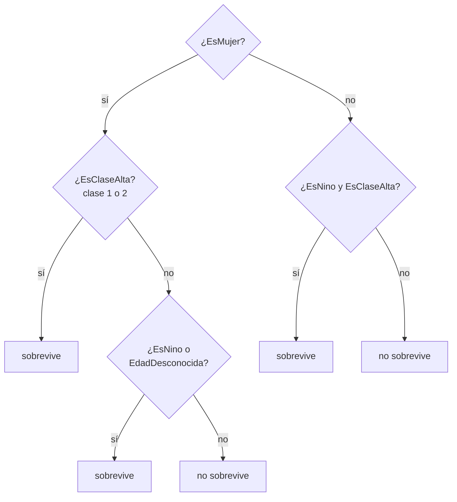

# Minería de datos — Titanic

API en C# que clasifica pasajeros del Titanic con un árbol de decisión corto. El árbol no se calcula: está escrito en `ArbolDecision.cs` y cada pregunta es una función.

Al arrancar se lee `train.csv` (891 pasajeros). `GET /arbol` muestra el esquema. `POST /clasificar` recorre las funciones con un pasajero nuevo.

## Cómo correrla

Requiere el SDK de .NET 7.

```bash
cd data-mining
dotnet run
```

Abre [http://localhost:5217/swagger](http://localhost:5217/swagger).

## Endpoints

| Método | Ruta | Qué devuelve |
|---|---|---|
| `GET` | `/arbol` | El árbol en texto y cuántos pasajeros hay en el CSV. |
| `POST` | `/clasificar` | `sobrevive` o `no sobrevive`, y el camino de funciones que siguió. |

Ejemplo:

```http
POST /clasificar
Content-Type: application/json

{ "sexo": "mujer", "clase": 3, "edad": 8 }
```

`sexo` acepta `mujer` / `hombre` o `female` / `male`. `clase` es 1, 2 o 3. Si omites `edad`, el grupo es `desconocido`.

Con la misma mujer de tercera clase, edad 8 predice **sobrevive** y edad 30 predice **no sobrevive**.

## Cómo decide

1. `EsMujer` parte el árbol.
2. Si es mujer, `ClasificarMujer` pregunta `EsClaseAlta` (clase 1 o 2). En tercera clase sigue si es `EsNino` o `EdadDesconocida`.
3. Si es hombre, `ClasificarHombre` solo clasifica como sobrevive a un niño de clase 1 o 2.

Niño es edad menor de 16. Si `Age` viene vacía en el CSV, el grupo es `desconocido`.



## Dataset

`data-mining/Data/train.csv` es el `train.csv` público del Titanic. Se leen `Survived`, `Pclass`, `Sex` y `Age`. El resto de columnas se ignora.

## Código

| Archivo | Rol |
|---|---|
| `ArbolDecision.cs` | El árbol: las preguntas y la clasificación. |
| `Pasajero.cs` | Una fila del Titanic. |
| `LectorCsv.cs` | Lee el CSV. |
| `Program.cs` | Carga los datos al arrancar y publica los endpoints. |
